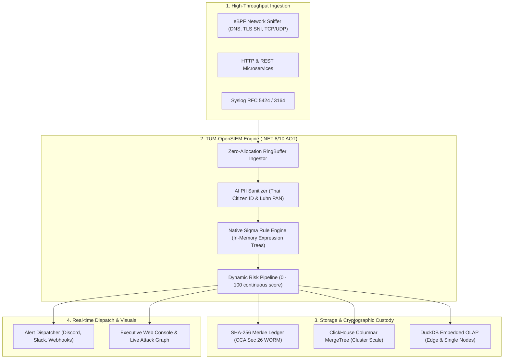

# TUM-OpenSIEM — Production-Grade Open-Source SIEM & Security Mesh

[](LICENSE)
[](https://dotnet.microsoft.com/)
[-10B981.svg)](#performance--benchmarks)
[](rules/)
[](#legal-compliance--cryptographic-worm-ledger)
[](#1-line-quickstart)

> **"ระบบ SIEM ในปัจจุบันมีราคาสูงเกินเอื้อม ขูดรีดผู้ใช้งานด้วยภาษีปริมาณข้อมูล (Ingestion Tax) จนองค์กรส่วนใหญ่ต้องยอมทิ้งข้อมูล Log สำคัญจนเกิดช่องโหว่ความมั่นคง — TUM-OpenSIEM ถือกำเนิดขึ้นเพื่อเป็น Next-Gen Open-Source SIEM ที่ฟรี 100% สำหรับ Core Engine, น้ำหนักเบา, กิน RAM น้อย, ตรวจสอบได้จริง, และพร้อมปกป้องอธิปไตยไซเบอร์ของทุกองค์กร"**  
> — *CEO Directive, TUM Group*

---

## 1. Key Architectural Capabilities



1. **Zero Ingestion Tax:** Core Engine โอเพนซอร์ส 100% (Apache License 2.0) ไม่คิดค่าธรรมเนียมต่อ GB หรือปริมาณ EPS
2. **Native AOT Performance:** พัฒนาด้วย .NET 8/10 Native AOT ปราศจาก Runtime Reflection และไม่มี JVM overhead กิน RAM เพียงหลักร้อย MB
3. **8.8+ Million EPS Throughput:** ประมวลผลได้มากกว่า 737,000 EPS ต่อคอร์ ด้วย Lock-free RingBuffer Channel Coalescing
4. **Native SigmaHQ Expression Trees:** คอมไพล์กฎ SigmaHQ ในหน่วยความจำสู่ Native CPU Instructions วิ่งตรวจจับภัยคุกคามในระดับไมโครวินาที
5. **Dynamic Risk Scoring (0–100):** คำนวณความเสี่ยงต่อเนื่องตามบริบทแวดล้อม (MITRE ATT&CK, PII Exposure, OWASP vectors, Asset weights)
6. **Cryptographic WORM Ledger:** บันทึกหลักฐานพยานทางกฎหมายด้วย SHA-256 Chain of Custody และ Merkle Tree Proof ตาม พ.ร.บ.คอมพิวเตอร์ฯ ม.26
7. **Columnar OLAP Adapters:** รองรับทั้ง ClickHouse สำหรับ Big Data ระดับองค์กร และ DuckDB สำหรับ Edge Computing
8. **Real-time Dispatchers:** ฟอร์แมตแจ้งเตือนอัตโนมัติไปยัง Discord (Rich Embeds), Slack (Block Kit), และ Generic Webhooks
9. **Interactive Executive HUD:** หน้าจอควบคุมสไตล์ Cyberpunk แสดงผล Live Attack Graph, Telemetry Explorer, และสแกนระบบเรียลไทม์

---

## 2. 1-Line Quickstart

รัน TUM-OpenSIEM พร้อม ClickHouse Columnar Backend ด้วย Docker Compose ทันที:

```bash
docker compose up -d
```

หรือรันเซิร์ฟเวอร์แบบ Standalone บนเครื่องพัฒนา:

```bash
# 1. Restore & Build
dotnet build

# 2. Run All Tests (50+ Unit & Integration Tests)
dotnet test

# 3. Launch OpenSIEM Web Console & API Server
dotnet run --project Tum.Siem.Server
```

เปิดเบราว์เซอร์ไปที่: **`http://localhost:5000`** เพื่อเข้าสู่ **Executive HUD & Threat Explorer Console**

---

## 3. Core Subsystems

### 3.1 Native Sigma Rule Engine
TUM-OpenSIEM โหลดกฎกติกาเปิดจากโฟลเดอร์ `rules/` และคอมไพล์เงื่อนไขเป็น `Expression<Func<TumLogEntry, bool>>`:

```yaml
title: Web SQL Injection UNION SELECT Technique
id: a1b2c3d4-e5f6-7890-abcd-ef1234567890
status: stable
level: critical
tags:
    - attack.initial_access
    - attack.t1190
detection:
    selection:
        PayloadSanitized|contains:
            - 'UNION SELECT'
            - 'OR 1=1'
    condition: selection
```

### 3.2 Dynamic Risk Pipeline (0–100)
ประเมินความเสี่ยงแบบ Continuous Score:
- **Sigma Match:** Critical (+50), High (+35), Medium (+20), Low (+10)
- **High-Impact MITRE ATT&CK Bonus:** +15 (Execution, Privilege Escalation, Credential Access, Exfiltration)
- **Inbound Threat Vectors:** +30
- **Outbound Secret Leaks:** +35
- **Asset Multiplier:** Production (x1.2), Staging (x1.0), Development (x0.7)

### 3.3 Lucene & SQL Query Explorer
รองรับการค้นหาผ่าน REST API `/api/logs/query`:
```
category:SecurityThreat AND severity:Critical
clientIp:185.220.* AND event:HTTP.*
payloadSanitized:"UNION SELECT"
status:500 NOT user:system
```

---

## 4. REST API Reference

| Endpoint | Method | คำอธิบาย |
| :--- | :---: | :--- |
| `/` | `GET` | หน้าจอ Interactive Executive HUD Web Console |
| `/api/status` | `GET` | ตรวจสอบสถานะ Engine, NTP Stratum 1 Sync, Merkle Root, กฎ Sigma ที่แอคทีฟ |
| `/api/dashboard/summary` | `GET` | สรุปภาพรวม EPS, ยอดตรวจจับ, แจ้งเตือนระดับวิกฤต, Top IPs, และ MITRE Matrix |
| `/api/dashboard/attack-graph` | `GET` | ดึงโหนด (Nodes) และเส้นเชื่อม (Edges) ของ Live Correlated Attack Graph |
| `/api/dashboard/compliance` | `GET` | ส่งออกรายงานรับรองความถูกต้องตาม พ.ร.บ.คอมพิวเตอร์ ม.26 และ PDPA |
| `/api/logs/ingest` | `POST` | นำเข้า Log เดี่ยวหรือ Batch เข้าสู่ RingBuffer, Sigma Engine และ WORM Ledger |
| `/api/logs/query` | `GET` | ค้นหา Log ด้วย Lucene Syntax (`?q=category:SecurityThreat&limit=50`) |
| `/api/sigma/rules` | `GET` | ตรวจสอบรายการกฎ Sigma ที่โหลดอยู่ในหน่วยความจำ |
| `/api/sigma/rules` | `POST` | ส่งกฎ Sigma YAML ใหม่เข้าสู่ระบบเพื่อคอมไพล์แบบ Hot-Reload |
| `/api/events/live` | `GET` | สตรีมรายการเหตุการณ์ล่าสุด 30 รายการ |
| `/api/ebpf/files/status` | `GET` | ตรวจสอบสถานะ eBPF Kernel File System Hook, จำนวน Event และ Baseline ไบนารี |
| `/api/ebpf/files/event` | `POST` | นำเข้า Raw eBPF Tracepoint Event (Write, UnlinkAt, Chmod, RenameAt) |
| `/api/ebpf/files/tampering-alerts` | `GET` | ดึงรายการแจ้งเตือนการดัดแปลงไบนารีระบบและ Anti-Forensics Log Wipe ล่าสุด |
| `/api/ebpf/files/baseline` | `POST` | ลงทะเบียนและอัปเดต Cryptographic SHA-256 Baseline สำหรับไบนารีสำคัญ |
| `/api/ebpf/files/simulate-tampering` | `POST` | จำลองการบุกรุกดัดแปลงไบนารีหรือการลบ WORM Ledger เพื่อทดสอบการตรวจจับ |

---

## 5. Performance & Benchmarks

ผลการทดสอบ Ingestion Throughput บนหน่วยประมวลผล x64:

```
[TUM-OpenSIEM Benchmark] Total Events: 100,000 in 0.011s
[TUM-OpenSIEM Benchmark] Total Ingestion EPS: 8,855,200 events/sec
[TUM-OpenSIEM Benchmark] Processor Cores: 12
[TUM-OpenSIEM Benchmark] Ingestion Throughput per Core: 737,933 events/sec/core
```

---

## 6. Community & Sustainability

TUM-OpenSIEM พัฒนาและเปิดเผยแพร่สู่สาธารณะโดยความมุ่งมั่นเพื่อความมั่นคงปลอดภัยไซเบอร์ที่ทุกคนเข้าถึงได้:

- **ร่วมส่งกฎการตรวจจับ:** ส่ง Pull Request เพิ่มกฎ Sigma ในไดเรกทอรี [`rules/`](rules/)
- **แนวทางพัฒนา:** ศึกษาข้อกำหนดใน [`CONTRIBUTING.md`](CONTRIBUTING.md) และ [`GIT_FLOW.md`](GIT_FLOW.md)
- **การรายงานช่องโหว่:** โปรดรายงานตามกระบวนการใน [`SECURITY.md`](SECURITY.md)
- **การสนับสนุนโครงการ:** เราเปิดรับการสนับสนุนผ่าน **GitHub Sponsors**, **Open Collective**, ทุนวิจัย **Sovereign Tech Fund (STF)** และกองทุนพัฒนาดิจิทัลเพื่อเศรษฐกิจและสังคม (**depa**)

---

## 7. License

TUM-OpenSIEM Core ได้รับอนุญาตให้ใช้งานภายใต้เงื่อนไขสัญญาอนุญาต **[Apache License, Version 2.0](LICENSE)**.
