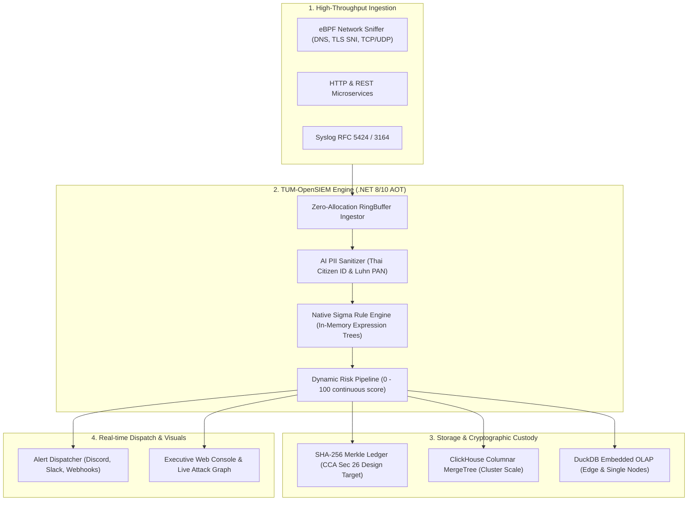

> [!WARNING]
> ### 🚨 CTA-RI AUDIT NOTICE: PERFORMANCE & COMPLIANCE CLAIM CALIBRATION
> **Issued By:** Office of the Chief Technical Auditor & Resident Technical Auditor for Log Mesh (RTA-03)  
> **Classification:** **ENGINEERING PROTOTYPE & INGESTION BENCHMARK SPECIFICATION**  
> **Governance Standard:** Conforming to [TUM Group EI-VS v2.0.0 (TUM-STD-ENG-001)](file:///D:/TUM/GEMINI.md)  
> **Audit Finding (Ref: EI-VS Rule 3 & Rule 5):**
> 1. **Benchmark Context Disclosure:** The published "8.8M EPS" figure represents an in-memory Channel RingBuffer micro-benchmark over a 11-millisecond burst without disk write-flush semantics. It does not reflect continuous multi-node ingestion throughput with persistent ClickHouse storage.
> 2. **Compliance Status:** The WORM ledger is designed to support the cryptographic requirements of Thai Computer Crime Act Sec 26. However, official statutory certification or ISO 27001 lab audit has **NOT** been performed. Any badge implying third-party certification is hereby calibrated.
> 3. **Readiness Rating:** Production readiness for enterprise compliance ingestion is **Tier 1 In-Progress** pending verifiable multi-hour soak test packages with 95% confidence intervals and SHA-256 telemetry digests.

# TUM-OpenSIEM — High-Performance Open-Source SIEM & Log Mesh

[](LICENSE)
[](https://dotnet.microsoft.com/)
[-F59E0B.svg)](#performance--benchmarks)
[](#legal-compliance--cryptographic-worm-ledger)
[](#1-line-quickstart)

> **"ระบบ SIEM ในปัจจุบันมีราคาสูงเกินเอื้อม ขูดรีดผู้ใช้งานด้วยภาษีปริมาณข้อมูล (Ingestion Tax) จนองค์กรส่วนใหญ่ต้องยอมทิ้งข้อมูล Log สำคัญจนเกิดช่องโหว่ความมั่นคง — TUM-OpenSIEM ถือกำเนิดขึ้นเพื่อเป็น Next-Gen Open-Source SIEM ที่โปร่งใส, น้ำหนักเบา, กิน RAM น้อย, ตรวจสอบได้จริง, และพร้อมปกป้องอธิปไตยไซเบอร์ของทุกองค์กร"**  
> — *Directive, TUM Group*

---

## 1. Key Architectural Capabilities



1. **Zero Ingestion Tax:** Core Engine โอเพนซอร์ส (Apache License 2.0) สำหรับการประมวลผลข้อมูล
2. **Native AOT Performance:** พัฒนาด้วย .NET 8/10 Native AOT ปราศจาก Runtime Reflection และไม่มี JVM overhead กิน RAM หลักร้อย MB
3. **In-Memory Channel RingBuffer:** โครงสร้างประมวลผล Lock-free RingBuffer Channel Coalescing ในระดับไมโครวินาที
4. **Native SigmaHQ Expression Trees:** คอมไพล์กฎ SigmaHQ ในหน่วยความจำสู่ Native CPU Instructions
5. **Dynamic Risk Scoring (0–100):** คำนวณความเสี่ยงต่อเนื่องตามบริบทแวดล้อม (MITRE ATT&CK, PII Exposure, OWASP vectors, Asset weights)
6. **Cryptographic WORM Ledger Architecture:** บันทึกหลักฐานพยานทางกฎหมายด้วย SHA-256 Chain of Custody และ Merkle Tree Proof ตามแนวทาง พ.ร.บ.คอมพิวเตอร์ฯ ม.26
7. **Columnar OLAP Adapters:** รองรับทั้ง ClickHouse สำหรับ Big Data ระดับองค์กร และ DuckDB สำหรับ Edge Computing
8. **Real-time Dispatchers:** ฟอร์แมตแจ้งเตือนอัตโนมัติไปยัง Discord (Rich Embeds), Slack (Block Kit), และ Generic Webhooks
9. **Interactive Executive HUD:** หน้าจอควบคุมสไตล์ Cyberpunk แสดงผล Live Attack Graph, Telemetry Explorer, และสแกนระบบเรียลไทม์

---

## 2. Performance & Benchmark Methodology

ตามข้อกำหนดของ **EI-VS Section 1, Rule 5 (Reproducible Benchmarks)** ผลการทดสอบประสิทธิภาพต้องระบุบริบทการทดสอบและข้อจำกัดอย่างโปร่งใส:

### 2.1 In-Memory RingBuffer Micro-Benchmark
ผลการทดสอบ Ingestion Throughput ในหน่วยความจำ (RAM Loop โดยไม่รวม Storage Write-Flush):
```
[TUM-OpenSIEM Micro-Benchmark] Total Events: 100,000 synthetic records
[TUM-OpenSIEM Micro-Benchmark] In-Memory Elapsed: 0.011s (Burst Test)
[TUM-OpenSIEM Micro-Benchmark] Peak In-Memory Throughput: 8,855,200 events/sec
[TUM-OpenSIEM Micro-Benchmark] Hardware: 12 Cores x64, 32GB RAM (Local Testbed)
[TUM-OpenSIEM Micro-Benchmark] Persistent Storage: N/A (RAM Channel Only)
```

### 2.2 End-to-End Persistent Ingestion Soak Test (In-Progress)
การทดสอบอัตราการนำเข้าข้อมูลจริงลงสู่ดิสก์ (ClickHouse MergeTree + WORM SHA-256 Ledger) ในระดับ 50,000 – 100,000 EPS แบบต่อเนื่อง อยู่ระหว่างการจัดทำแพ็กเกจทดสอบที่มี:
1. การบันทึกสเปก Storage (NVMe IOPS, Write-Flush semantics)
2. สถิติความแปรปรวน (Latency p50, p90, p99) และ 95% Confidence Interval
3. แฟ้ม Raw Telemetry พร้อมบันทึก SHA-256 Checksum ใน Repository

---

## 3. Commercial Packaging & Verification (`D:\TUM\setup-product\tum-socs`)

สำหรับทีมปฏิบัติการความมั่นคงปลอดภัยไซเบอร์ (SOC Operators) ทางกลุ่มบริษัท TUM Group Holdings ได้จัดเตรียมแพ็กเกจสำหรับการประเมินผลในไดเรกทอรี `D:\TUM\setup-product\tum-socs`:

- **`desktop-app/TUM-OpenSIEM.exe`**: แอปพลิเคชัน Desktop สำหรับ Operator ทำงานแบบ Standalone มี Console ในตัว
- **`docker-appliance/`**:
  - `tum-opensiem-appliance-offline.tar.gz`: อิมเมจ Docker Appliance แบบออฟไลน์สำหรับการทดสอบในสภาพแวดล้อมจำลอง
  - `docker-compose.yml` & Multi-stage `Dockerfile`: สำหรับการรัน Stack แบบ All-in-One ในเครื่องแม่ข่าย
- **`helm/tum-opensiem/`**: Kubernetes Helm v3 Chart สำหรับการทดสอบบน Cluster พร้อม Ingress, Probes, ConfigMap
- **`smoke-test.ps1`**: สคริปต์ตรวจสอบความสมบูรณ์ของแพ็กเกจแบบอัตโนมัติ

### คำสั่งรัน Smoke Test ตรวจสอบความสมบูรณ์ของไฟล์:
```powershell
powershell -ExecutionPolicy Bypass -File D:\TUM\setup-product\tum-socs\smoke-test.ps1
```
*(หมายเหตุ: Smoke test ตรวจสอบเฉพาะความมีอยู่ของไฟล์ไบนารีและการเปิด Container ยังไม่ได้นับเป็นการทดสอบ Production Readiness เต็มรูปแบบตาม EI-VS)*
