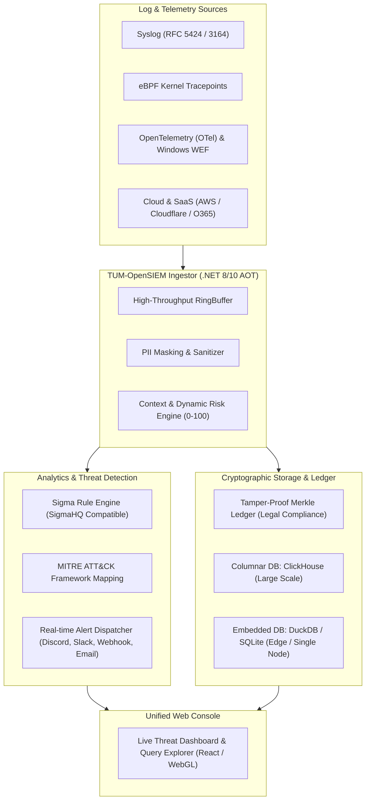

# RFC: TUM-OpenSIEM — Production-Grade Open-Source SIEM Architecture & Community Blueprint

- **Document ID:** `RFC-SOCS-001`
- **Jira Epic / Issue:** [`SCRUM-6`](https://daywakler.atlassian.net/browse/SCRUM-6)
- **GitHub Tracking:** [`PasitTum/tum-socs#2`](https://github.com/PasitTum/tum-socs/issues/2)
- **Status:** Approved by CEO 🟢 — Transitioned to Active Execution
- **Target Release:** Sprint Q1–Q2
- **License:** Apache License 2.0 (Open-Source Core)

---

## 1. Executive Summary & Vision (วิสัยทัศน์โครงการ)

โครงการ **TUM-OpenSIEM** ถือกำเนิดขึ้นจากดำริของผู้บริหารระดับสูง (CEO Directive) เพื่อแก้ไขปัญหาความเจ็บปวด (Pain Point) เรื้อรังของวงการความมั่นคงปลอดภัยไซเบอร์: **"ระบบ SIEM ในปัจจุบันมีราคาสูงเกินเอื้อม ขูดรีดผู้ใช้งานด้วยภาษีปริมาณข้อมูล (Ingestion Tax) จนองค์กรส่วนใหญ่ต้องยอมทิ้งข้อมูล Log สำคัญจนเกิดช่องโหว่ความมั่นคง"**

**TUM-OpenSIEM** จะเป็น **Next-Generation Open-Source SIEM** ที่:
1. **ฟรี 100% สำหรับ Core Engine (Apache 2.0):** ติดตั้งใช้งานเองได้ ไม่จำกัดจำนวนเครื่อง ไม่คิดค่า Ingestion ต่อ GB หรือ EPS
2. **ประสิทธิภาพสูงและน้ำหนักเบา (Ultra-Lightweight):** พัฒนาด้วย **.NET 8/10 AOT** และ **Zero-Allocation RingBuffer** กิน RAM เพียงหลักร้อย MB ทดแทนระบบเดิมที่พึ่งพา Java/Elasticsearch
3. **เปิดรับ Developer & Security Community:** ให้นักพัฒนาและ Threat Hunter ทั่วโลกสามารถร่วม Contribute ทั้ง Code, Log Parsers และ Detection Rules
4. **ความยั่งยืนทางการเงิน (Sustainability):** สนับสนุนโดย Community Sponsorships, Public Tech Grants, Managed Cloud SaaS และ Enterprise Compliance Services

---

## 2. Market Pain Points vs. TUM-OpenSIEM Solutions

| ความเจ็บปวดจาก SIEM ปัจจุบัน (Splunk, Sentinel, QRadar) | ทางออกของ TUM-OpenSIEM |
| :--- | :--- |
| **Ingestion Tax:** จ่ายแพงขึ้นเรื่อยๆ ตามขนาด GB/Day หรือ EPS | **Zero Ingestion Cost:** รันบนทรัพยากรของตนเองได้อย่างอิสระ ไม่จำกัด Data Volume |
| **Heavy Resource Footprint:** Elasticsearch/JVM กิน RAM 16-64 GB | **Native AOT C# & ClickHouse:** ใช้ RAM เพียง 256 MB – 2 GB รองรับ Throughput สูง |
| **Proprietary Rules & Lock-in:** กฎการตรวจจับใช้ภาษาเฉพาะของแต่ละค่าย | **Open Sigma Rules (SigmaHQ):** รองรับมาตรฐานเปิดสากล นำกฎที่มีอยู่แล้วนับพันมาใช้ได้ทันที |
| **Log Tampering Risk:** แฮกเกอร์ลบหรือแก้ไข Log ได้เมื่อบุกรุกถึง Host | **Cryptographic Merkle Ledger:** พิสูจน์ความแท้จริงของ Log ด้วย SHA-256 Chaining & Merkle Proof |
| **Setup Complexity:** ต้องใช้วิศวกรเฉพาะทางเซ็ตอัปหลายสัปดาห์ | **Zero-Friction 1-Line Deployment:** ติดตั้งพร้อมใช้งานผ่าน Docker Compose ใน 60 วินาที |

---

## 3. High-Level Technical Architecture

---

## 4. Community & Sustainability Framework (โมเดลคอมมูนิตี้และความยั่งยืน)

### 4.1 Developer & SecOps Community Building
- **Open GitHub Repository:** โค้ดทั้งหมดเปิดให้เข้าถึงและ Fork ได้อิสระภายใต้สัญญาอนุญาต Apache 2.0
- **Sigma Rule Contribution:** สร้างโฟลเดอร์ `rules/` เพื่อให้คอมมูนิตี้ส่ง Pull Request เพิ่มกฎการตรวจจับภัยคุกคามใหม่ๆ
- **Log Parser Ecosystem:** เปิด Interface `ILogParser` เพื่อให้นักพัฒนาเขียน Parser รองรับแอปพลิเคชันหรือไฟร์วอลล์ยี่ห้อต่างๆ
- **Community Channels:** มีช่องทาง Discord (`#tum-socs-community`) และ GitHub Discussions สำหรับช่วยเหลือแลกเปลี่ยนความรู้

### 4.2 Financial Sustainability & Monetization
1. **Community Sponsors:** เปิดรับการสนับสนุนผ่าน GitHub Sponsors และ Open Collective
2. **Public Infrastructure Grants:** ยื่นขอรับทุนวิจัยพัฒนาจาก **Sovereign Tech Fund (STF)** และกองทุนพัฒนาดิจิทัลเพื่อเศรษฐกิจและสังคม (depa / ววน.)
3. **Managed Cloud (SaaS):** ให้บริการโฮสต์ TUM-OpenSIEM Cloud คิดค่าบริการตามโครงสร้างพื้นฐานสำหรับองค์กรที่ไม่อยากดูแลเซิร์ฟเวอร์เอง
4. **Enterprise Support & Compliance Packs:** บริการดูแลระดับองค์กรแบบ 24/7 SLA พร้อมรายงานตามมาตรฐาน **ISO 27001, PCI-DSS v4.0, พ.ร.บ.คอมพิวเตอร์ฯ และ PDPA**

---

## 5. Execution Roadmap (แผนปฏิบัติการ 4 เฟส)

### Sprint 1: Core Engine Modernization & ClickHouse/DuckDB Ingestion (ปัจจุบัน)
- ปรับปรุง `Tum.Log` สู่รูปแบบ Single-Binary Ready (.NET 8/10 AOT)
- สร้าง Adapter เชื่อมต่อ Columnar Storage (ClickHouse & DuckDB)
- ทดสอบ Ingestion Throughput เกิน 50,000 EPS ต่อคอร์

### Sprint 2: Native Sigma Rule Engine & Alert Dispatcher
- พัฒนา Engine แปลงกฎ **Sigma Rules** เป็น In-Memory Expression Trees
- เพิ่มระบบประเมินค่าความเสี่ยงไดนามิก (0–100) และเชื่อมโยง Alert ไปยัง Webhook/Discord
- ทำระบบ 1-Line Quickstart ด้วย `docker-compose.yml`

### Sprint 3: Web Dashboard & Visual Event Explorer
- พัฒนา Dashboard สวยงาม น้ำหนักเบา รองรับ Search Query ภาษา Lucene/SQL-like
- แสดงผล Live Attack Graph และสรุป Compliance Report อัตโนมัติ

### Sprint 4: Public Open-Source Launch & Community Engagement
- เปิดตัว Repository สู่สาธารณะ พร้อมคู่มือ CONTRIBUTING.md และ Code of Conduct
- จัดทำแคมเปญเปิดรับ Sigma Rules Contribution แรก พร้อมประกาศรับ Sponsorship
